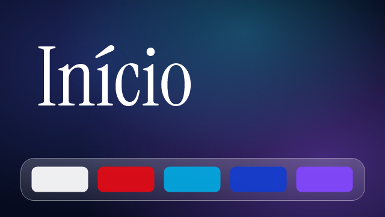
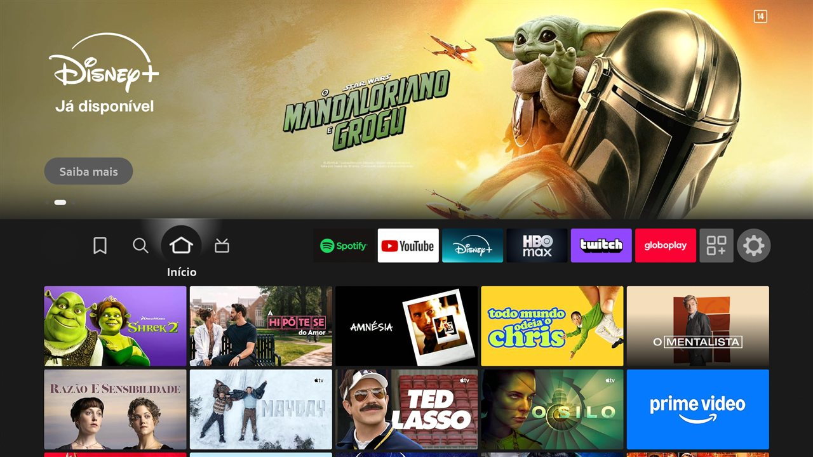
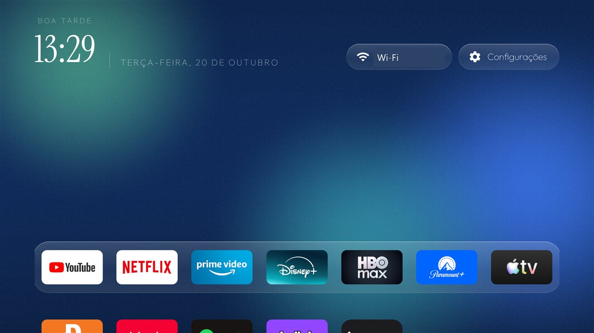
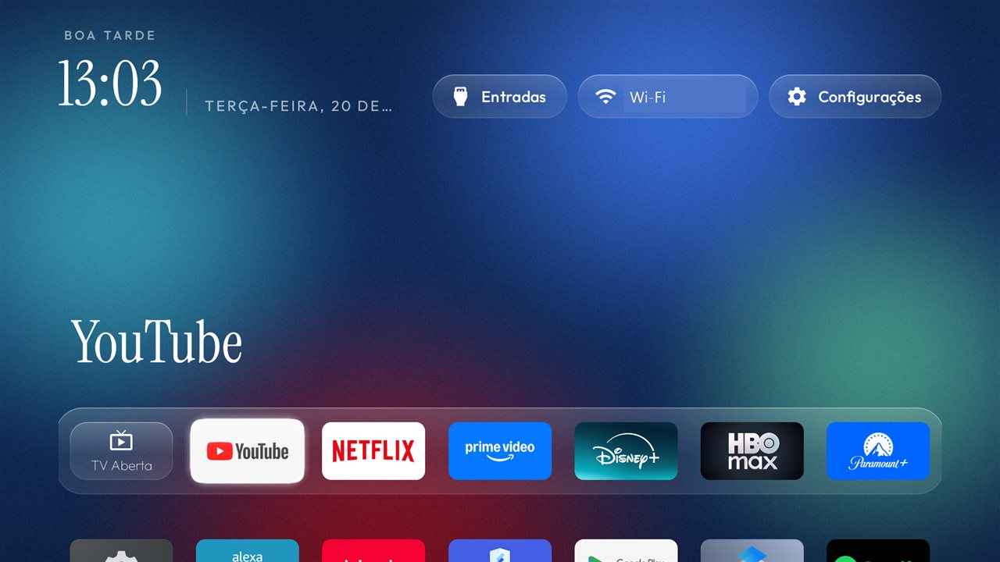
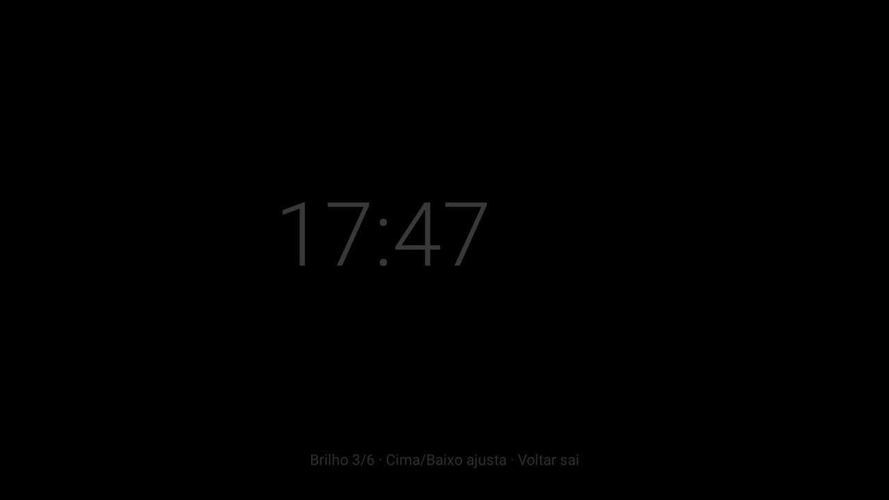

<p align="center"></p>

# TV Otimizada

Limpeza, home no estilo glass e um app para dormir com música, para **Fire TV Stick** e **TV TCL com Google TV**. Sem root, nada desinstalado, e cada mudança tem o comando que a desfaz.

Este repositório junta ideias e código de **três projetos open source diferentes**, adapta tudo para dois aparelhos reais e acrescenta peças novas. A seção [Uma mescla de três projetos](#uma-mescla-de-três-projetos) diz exatamente o que veio de cada um e o que foi escrito aqui.

## Resultados

Medido pelo adb (`/proc/meminfo` e `dumpsys meminfo`), com o aparelho parado na tela inicial. O relatório completo está em [`docs/relatorio.html`](docs/relatorio.html) (baixe e abra no navegador).

| | TCL 98C6K · Google TV 14 · 2,4 GB | Fire TV Stick Lite · Fire OS 7.7 · 1 GB |
|---|---|---|
| Memória disponível | 924 → **1.082 MB** (+17%) | 248 → **265 MB** (chegou a 280 MB antes da home nova) |
| Estado da memória (Android) | normal → normal | **crítico → normal** |
| RAM em uso | 1.644 → 1.615 MB | 822 → **614 MB** (−25%) |
| Pacotes desligados | 34 (127 MB que eles ocupavam) | 41 |
| Rastreamento do que você assiste | Samba TV desligado | `tv.acr` desligado + DNS de anúncios |
| Animações / protetor de tela | 1,0× → 0 / desligado | 1,0× → 0 / desligado |
| Tela inicial | Google TV → home glass com **TV Aberta** | Amazon → home glass, céu parado (0% de CPU) |

## Capturas

| Fire TV: original | Fire TV: otimizado |
|---|---|
|  |  |

| TCL: home glass com TV Aberta | App Dormir |
|---|---|
|  |  |

## Uma mescla de três projetos

| Projeto | Autor | O que veio de lá | Licença |
|---|---|---|---|
| [tv-detox](https://github.com/Ansub/tv-detox) | Ansub Khan | O processo: backup antes de tudo, apps em 3 grupos com aprovação, `pm disable-user` em vez de desinstalar, log com o comando de desfazer | MIT |
| [cleanyourtv](https://github.com/Gathin23/cleanyourtv) | Gathin23 | A base da home (`launcher/`): grade de apps, dock, menu de entradas, protetor de relógio, cartões de módulo; e a lista testada da TCL G08 | MIT |
| [fireglass](https://github.com/bhaweshverma50/fireglass) | Mihir Gupta | O visual: vidro desenhado (`Glass.java`), céu vivo que segue a hora (`SkyView.java`), a serifa Instrument Serif; e a técnica de devolver a home no Fire OS | MIT |

Os avisos de copyright originais estão em [`launcher/LICENSE-cleanyourtv`](launcher/LICENSE-cleanyourtv) e [`launcher/LICENSE-fireglass`](launcher/LICENSE-fireglass), e os arquivos portados dizem de onde vieram no cabeçalho. As fontes seguem a SIL Open Font License ([Outfit](launcher/FONT-LICENSE-OFL.txt), [Instrument Serif](launcher/FONT-LICENSE-InstrumentSerif-OFL.txt)).

### O que foi feito aqui

- **App Dormir** (`launcher/dormir/`): tela escura com relógio flutuante que mantém a TV acordada enquanto o Spotify toca. O brilho se ajusta no controle (Cima/Baixo) para achar o nível mais escuro que a TV aceita sem achar que está "sem sinal".
- **Bloco TV Aberta**: o app de TV da TCL vira o primeiro bloco e abre sempre na antena, mesmo vindo de um HDMI.
- **Botão Home sem desligar a home original**: na TCL o serviço de acessibilidade captura a tecla Home. No Fire OS ele observa a home da Amazon e volta por um alarme do sistema. Tem ainda um modo Configurações que não briga com a aba de configurações da Amazon.
- **Atalho "Fire OS"** (só no Fire TV, para testes): abre a home original da Amazon e pausa o bate-volta até você abrir a home nova de novo.
- **Céu parado no Fire TV**: no Stick de 1 GB, o céu é desenhado uma vez e só redesenha na troca de cor.
- **Logo nova** da home (banner e ícone) e **tradução pt-BR** completa da interface.
- **Correções**: ícone de bloco centralizado e sem corte, e dock que serve aos dois aparelhos.
- **Scripts com log e desfazer** (`scripts/`) e as **listas de pacotes** dos dois aparelhos (`listas/`).
- **Relatório de desempenho** Original × Otimizado.

## Estrutura

```
launcher/            projeto Android (Gradle): app/ = home glass, dormir/ = app Dormir
scripts/             desligar-apps, ajustes, instalar-home, reativar-home (TCL)
listas/              pacotes desligados em cada aparelho
docs/                relatório e capturas
```

## Como usar

Você precisa de: `adb` ([Platform-Tools](https://developer.android.com/tools/releases/platform-tools)), JDK 17 e Android SDK (platform 34, build-tools 34) para compilar, e um shell `sh` (no Windows, Git Bash). Na TV, ligue a depuração (USB ou sem fio) e aceite o pedido do computador.

1. **Backup** (recomendado):
   ```sh
   adb -s IP:porta shell pm list packages -f > apps.txt
   for ns in global system secure; do adb -s IP:porta shell settings list $ns > settings-$ns.txt; done
   ```
2. **Desligar o que não serve**: revise a lista e comente o que você usa.
   ```sh
   TV=IP:porta sh scripts/desligar-apps.sh listas/firetv-stick-lite.txt
   ```
3. **Animações e protetor de tela**:
   ```sh
   TV=IP:porta sh scripts/ajustes.sh
   ```
   Opcional, DNS que bloqueia anúncios e telemetria:
   ```sh
   TV=IP:porta sh scripts/ajustes.sh global private_dns_specifier dns.adguard-dns.com
   TV=IP:porta sh scripts/ajustes.sh global private_dns_mode hostname
   ```
4. **Compilar e instalar a home e o Dormir**:
   ```sh
   cd launcher && ./gradlew assembleRelease && cd ..
   TV=IP:porta sh scripts/instalar-home.sh
   ```
5. **TCL, só depois de um reinício completo**:
   ```sh
   TV=IP:porta sh scripts/reativar-home.sh
   ```

Cada script grava `alteracoes-log.txt` e gera `scripts/desfazer-tudo.sh`. Para voltar tudo:

```sh
sh scripts/desfazer-tudo.sh IP:porta
```

## Cuidados

- **Comente da lista o que você usa.** Desligar a Alexa no Fire TV faz o microfone do controle parar.
- **TCL G08 (Google TV 14):** não desligue `com.google.android.tungsten.setupwraith` nem a home do Google (`launcherx`). O Wi-Fi caiu na hora, e sem o assistente a home entra em loop. Por isso a troca da home é feita pela acessibilidade.
- **TCL:** o firmware zera a liberação de início automático a cada **reinício completo**. Desligar pelo controle não afeta.
- **Fire OS:** a home da Amazon não pode ser trocada nem desligada. Ao apertar Home ela aparece por 1 a 2 segundos antes da home nova voltar. Atualizações da Appstore podem religar apps; rode `desligar-apps.sh` de novo.
- **DNS:** o AdGuard tira telemetria e anúncios de terceiros, mas não o banner de destaque da Amazon nem os anúncios dentro dos streamings.
- **Dormir:** em TVs LCD/LED o preto ainda emite luz de fundo. Se a TV tiver "Desligar tela" ou "Somente áudio", use junto.

## Autoria e licença

Criado por **Geandre Colares** ([@geandreac](https://github.com/geandreac)) com o **Claude** (Anthropic) como par de programação, em outubro de 2026. O código escrito aqui está sob a licença MIT ([`LICENSE`](LICENSE)). As partes dos três projetos acima continuam sob a licença MIT de seus autores, com os avisos preservados.

Isto foi o que funcionou em dois aparelhos reais e não é garantia para o seu. Use por sua conta e mantenha o `desfazer-tudo.sh` por perto.
